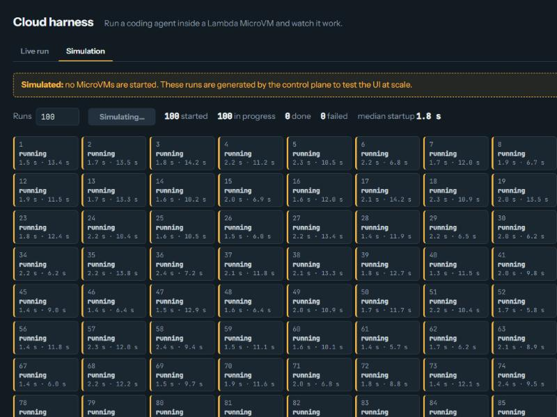

# Throwbox

**Give your AI agent a box you can throw away.** A sandboxed AI coding agent platform.

**Watch an AI coding agent work inside a disposable cloud computer.**

[](https://github.com/johnsiega/throwbox/actions/workflows/ci.yml)
[](LICENSE)


[What it is](#throwbox) · [Use cases](#use-cases) · [Try it](#try-it) · [How it works](#how-it-works) · [Run it yourself](#run-it-yourself) · [Using this project](#using-this-project) · [Contributing](#contributing)

Throwbox takes a public GitHub repository and a task written in plain words, such as "add a comment above this method". It starts a fresh, isolated virtual machine on AWS, lets an AI coding agent clone the repo, change the code, and run the project's tests, then shows you the result as a diff. You watch it happen live in three panels: what the agent is thinking, what it runs, and what changed.

If you like the change, one button pushes it to a new branch in a private repository. Nothing touches your own machine, and nothing is merged for you.

For example, you can ask for "add a one-line comment above `enabled()` in `app/Services/QueueEventLog.php`" and, usually within a minute (11 to 63 s in the measured runs), see the exact one-line patch, the passing test run, and a button that puts it on a branch.

## Why we built it

AI agents write and run code. Letting one do that on your own laptop means trusting it with your files, your credentials and your network. A throwaway virtual machine that starts in seconds and is destroyed when the run ends changes that trade-off.

**Status: v1.0.0**, a finished prototype. This project explores that idea end to end: the isolation, how fast it starts, what it costs, how to watch the agent without trusting it, and how to get its work out safely. It is a working prototype, built step by step with tests first, and it records what was measured and what was not.

## Use it

Throwbox is MIT-licensed software that you run yourself. There is no hosted version: your AWS account, your keys, your cost. Pick how far you want to go.

| Level | You need | You get |
|---|---|---|
| **1. Look** (a few minutes) | git, Node.js 22.18 or newer | The UI and the 100-run **simulation**. No accounts, no keys, no cost. |
| **2. Run real agents** | Level 1, an AWS account with Lambda MicroVMs in `us-east-1`, the AWS CLI, an OpenRouter key | An agent working on any public GitHub repo, in your account. See [Run it yourself](#run-it-yourself). |
| **3. Ship the result** | Level 2 and a fine-grained GitHub token | [Push the diff to a branch](#optional-push-patches-to-a-branch), or [open a draft PR into your own repo](#optional-open-a-draft-pr-into-your-own-repo). |

Level 1:

```powershell
git clone https://github.com/johnsiega/throwbox
cd throwbox
npm install
npm run web:build
npm start
```

Then open <http://127.0.0.1:3000>. With no key and no image it starts in demo mode.

**Make it yours.** Type another OpenRouter model id in the **Model** box (other models can do much worse; see [Models](docs/VALIDATION.md)). Teach it another language in `scripts/runner/detect-tests.mjs`, or add tools to the sandbox in `scripts/runner/Dockerfile` and rebuild the image. See [CONTRIBUTING.md](CONTRIBUTING.md).

## Try it

To **see the UI with no AWS account and no key**, run the demo (below). To run a real agent you need your own AWS account and an OpenRouter key; see [Run it yourself](#run-it-yourself). With the control plane running, open <http://127.0.0.1:3000>.

1. Keep the default repository (`https://github.com/jyvnn/hospital-queue`) or paste another **public** GitHub repo.
2. Keep the default task or write your own, then press **Run task**.
3. Watch the progress rail: **Sandbox ready**, **Agent**, **Tests**, **Patch**. The large number is how long the virtual machine took to become ready.
4. Read along. **Reasoning** shows the agent's messages, **Terminal** shows the commands it ran, and **Diff** shows the change line by line.
5. Press **Copy diff**, or **Push to branch** if you set up a push target. A pushed run shows a link to its branch. Each run can be pushed once.

### Demo mode and the 100-run simulation

Start the control plane with no key and no image and it runs in **demo mode**: only the simulation works, and real runs and pushes answer 503 with how to enable them.

```powershell
npm install
npm run web:build
npm start
```

Open <http://127.0.0.1:3000>, choose the **Simulation** tab and press **Start simulation** (100 runs by default, up to 200). To get demo mode even when you have keys set, use `$env:HARNESS_DEMO = "1"`.



*Screenshot of the **simulation**: 100 fictional runs, no MicroVMs.*

The simulation is **not real**. The control plane generates seeded, fictional events and streams all of them over one connection, each tagged `simulated: true`; no MicroVM is started, no model is called, and nothing can be pushed. It exists to show the UI holding 100 live traces at once. The numbers for real concurrency are different and much smaller; see [What we measured](#what-we-measured).

## Use cases

Throwbox is a tool you run yourself, against your own AWS account. Here is what people could use it for. Some of these need a small change, and each says so.

| Use case | How |
|---|---|
| **Try an AI agent on code you don't trust yet.** The agent works in a throwaway VM, so a bad or malicious change never touches your machine. You read the diff before anything else happens. | Point it at any public repo, write the task, press **Run task**. |
| **Compare coding models on the same task.** Find out which cheap model actually finishes the job, how fast, and at what token cost, with a pass rate over several runs. | `SMOKE_RUNS=5 SMOKE_MODEL=<model> npm run smoke` prints pass rate, timing and token totals, and `SMOKE_OUT_DIR` saves each run's events and diff. Today it is scored against the demo task; to score another task, change `EDITED_FILE` in `scripts/smoke-test.ts`. |
| **Measure how fast a MicroVM starts.** The "Sandbox ready" number is submit-to-first-healthy-response on your account and region. | Run it a few times and read the rail, or run `node scripts/measure-startup.ts` for cold and warm cycles with median and p95 (it spends a little AWS money; see [the results](docs/DECISION_LOG.md)). |
| **Teach or demo how an agent works.** Reasoning, commands and the patch appear live in three panels, which makes it easy to talk through what the agent did and why. | Run the control plane and share your screen. |
| **Hand a reviewer a patch branch.** The agent never gets push rights. After you approve the diff, the control plane pushes it to a new branch of a private repo for someone else to review, or, for a repo you own, opens a draft pull request into it. | Set up the optional push target or draft PRs below. |
| **Learn from the code.** It is a small, test-first TypeScript project: server-sent events, secret redaction, a request guard against cross-site calls, safe `git` use, and a Firecracker sandbox. | Start with [`docs/DECISION_LOG.md`](docs/DECISION_LOG.md), then read the tests next to each module. |

## How it works

```
Browser ──► Control plane ──► AWS Lambda MicroVM ──► Codex CLI ──► AI model (OpenRouter)
  (React)     (Hono, 127.0.0.1)   (Firecracker VM)      │
     ▲              │                                    ▼
     │              │              clone ─► edit ─► run tests ─► git diff
     └── live events (SSE) ◄── polls the VM every 0.5 s ◄── results
```

- **The sandbox.** Each run gets its own AWS Lambda MicroVM, started from a prebuilt image that already contains Node, PHP, Composer, Python (with pytest), git and the Codex CLI. The VM is terminated when the run finishes.
- **The agent.** [Codex CLI](https://github.com/openai/codex) runs headless inside the VM and talks to a low-cost model through OpenRouter. The default is `deepseek/deepseek-v4.1-flash`.
- **The loop.** Clone the repo, let the agent edit, run the repo's tests (detected for you, or the command you type), and capture a binary-safe `git diff`.
- **The stream.** The control plane polls the VM for new events, parses them into a small set of event types, and streams them to the page over server-sent events. Every event is scrubbed for secrets first.
- **The patch.** To push, the control plane clones the repo fresh at the exact commit the sandbox started from, applies the diff, commits as "Cloud harness", and pushes `harness/<run id>`. The VM no longer exists by then, and the push token never goes near it.

## What we measured

Small samples on one machine in `us-east-1`, so treat these as indications, not benchmarks.

| What | Result |
|---|---|
| Time until the VM is ready, started from the image (call to first healthy response) | 20 measured runs: median 1.9 s, p95 2.3 s, range 1.3 to 2.4 s. The page shows about 1.3 to 3 s, a little higher because it polls every 0.25 s and includes creating the access token. |
| Time until a suspended VM is ready again (resume call to first healthy response) | 20 measured runs: median 1.8 s, p95 1.9 s. **Not faster than a cold start**, so there is no warm pool. |
| Time until the agent's first message | 13 real runs on 2026-11-25, started 2 to 5 at a time: median 6.8 s, range 4.4 to 45.7 s |
| A whole run (clone, edit, install, tests, diff) | the same 13 runs, started 2 to 5 at a time, so not comparable to a single run: median 15.4 s, range 10.6 to 62.9 s |
| Real runs at the same time | **4**, the most this account's 8 GB MicroVM memory quota allows (K = 2, 3 and 4 all succeeded; the fifth VM was refused). See [VALIDATION.md](docs/VALIDATION.md). |
| Model cost | about a fifth of a cent per run (an estimate; AWS compute cost not measured) |

Every number, with its sample size, date and source, is in [`docs/VALIDATION.md`](docs/VALIDATION.md), including what was **not** tested.

We compared four models with five real runs each. "Correct" means one added comment directly above the right method and nothing else.

| Model | Correct diffs | Median run |
|---|---|---|
| `deepseek/deepseek-v4.1-flash` (default) | 5 of 5 | 17 s |
| `particle-ai/particle-1` | 5 of 5 | 16 s |
| `qwen/qwen3-coder` | 4 of 5 | 20 s |
| `qwen/qwen3-coder-30b-a3b-instruct` | 2 of 5 | 51 s |

The smallest model often read the file again and again and never made the edit, so we dropped it.

## Data boundaries

Read this before pointing it at code you care about.

- **Your repository's code and your task text leave your machine.** The agent reads the files it needs and sends them, with your task, to OpenRouter and on to whichever model provider OpenRouter routes to. Their retention and training policies apply, not ours.
- **The sandbox has open internet access.** The agent and anything in the repository it runs (install scripts, tests) can contact any host. A malicious repository could try to send files out. Only run it on code you are willing to expose.
- **The OpenRouter key is inside the sandbox while a run is going.** It reaches the VM through the run's startup payload (never baked into the image) because Codex needs it there. The agent, and so a malicious repository, could read it and send it somewhere. **Use a dedicated key with a spending limit, and rotate it if you ran untrusted code.**
- **The key is kept out of logs, the UI and the stored run.** It is redacted from every stored event and every streamed byte, and tests assert it never appears in a request URL, header or runner body (`tests/unit/redaction.test.ts`, `tests/unit/microvm-launcher.test.ts`). The redaction matches the exact key text plus known token prefixes (`sk-or-`, `github_pat_`, `ghp_`), so it does not catch a transformed copy such as an encoded one.
- **The GitHub push and PR tokens never enter the sandbox.** They stay in the control plane; the VM is gone before any push or PR.
- **Simulated runs carry no data.** They are fictional and contact nothing.

## Safety choices

- The control plane listens on `127.0.0.1` only. It also rejects requests whose `Host` or `Origin` isn't local, because a web page open in your browser could otherwise start runs on your AWS account.
- The OpenRouter key reaches the VM only through the run's startup payload, never through the image. It is redacted from everything stored or streamed.
- The GitHub token stays in the control plane. A push can only create a new `harness/<run id>` branch. It never forces, never touches `main`, and each run can be pushed once.
- Git runs with prompts, credential helpers, your global config and every protocol except HTTPS turned off, and the token is passed through the environment, not the command line.
- The AWS user has a narrow policy: MicroVM actions, one S3 bucket, one build role and the MicroVM logs. It cannot touch ordinary Lambda functions or IAM.

## Run it yourself

Requirements: Node.js 22.18 or newer, an AWS account with Lambda MicroVMs in `us-east-1`, the AWS CLI, and an [OpenRouter](https://openrouter.ai) API key. The commands below are for PowerShell.

**1. Install and test.** The tests need no AWS access.

```powershell
npm install
npm test
```

**2. One-time AWS setup.** You need an S3 bucket for the image package, a build role that Lambda can assume (read the bucket, write CloudWatch Logs), and an IAM user whose policy allows `lambda:*Microvm*`, `lambda:PassNetworkConnector` on the two managed network connectors, `s3:PutObject` and `s3:GetObject` on the bucket, `iam:PassRole` for the build role (to `lambda.amazonaws.com`), and reading the MicroVM log group.

**3. Add your keys.** Create a `.env` file in the repo root. It is git-ignored.

```
OPENROUTER_API_KEY=your-openrouter-key
```

**4. Build the image.** This takes about three minutes, runs one real test task, and prints the image ARN.

```powershell
$env:AWS_PROFILE = "your-profile"
$env:SMOKE_BUCKET = "your-bucket"
$env:SMOKE_BUILD_ROLE_ARN = "arn:aws:iam::<account-id>:role/<build-role>"
npm run smoke
```

**5. Build the page and start the control plane.**

```powershell
npm run web:build
$env:MICROVM_IMAGE_ARN = "<image arn printed above>"
npm start
```

Open <http://127.0.0.1:3000>. Rebuild the image whenever anything in `scripts/runner/` changes.

### Test command

The form has an optional **Test command** box. It decides what runs after the agent has edited the code.

- **Blank (auto-detect).** The first match wins: PHP (`composer.json`: Composer install, then `php artisan test`, or PHPUnit when there is no `artisan`); Node (a `package.json` with a real `test` script: `npm ci`, falling back to `npm install`, then `npm test`); Python (pytest evidence such as `pytest.ini`, `conftest.py`, a `[tool.pytest` section in `pyproject.toml`, or `tests/test_*.py`: a pip install of `requirements.txt` if there is one, then `python3 -m pytest -q`). Anything else is **Tests not run: no tests found**.
- **`skip`.** Skips the test step.
- **Anything else** is run as the test command, inside the sandbox, with the same trust as the task text. At most 500 characters.

Node and Python dependency installs are limited to 180 seconds. If one fails or times out, the tests are not run ("dependencies could not be installed"). A step that is not run shows as a **grey "Tests not run"** with the reason. It never shows green, but it does not turn a good diff red either, so the run still ends done and the diff stays pushable. A test command that really fails still ends the run in error. Other languages (Go, Rust, Java) are not detected: type a command for those.

### Optional: push patches to a branch

Create a **private** GitHub repository that contains the same history as the repo you run against, for example a copy of its `main`. Turn GitHub Actions off in it. Create a fine-grained token limited to that one repository with **Contents: read and write**, and add two lines to `.env`:

```
GIT_PUSH_TOKEN=github_pat_...
PUSH_TARGET_URL=https://github.com/<you>/<private-repo>
```

Restart the control plane. Without a token the button is hidden.

### Optional: open a draft PR into your own repo

For repos you own, the diff panel can open a **draft pull request** into the repo the agent actually worked on, instead of pushing to the staging repo. It is opt-in and off unless both settings exist.

1. Create a fine-grained token limited to **only the repos you list**, with **Contents: read and write** and **Pull requests: read and write**. Give it a short expiry. It is separate from `GIT_PUSH_TOKEN`, which keeps its single-repo scope.
2. Add two lines to `.env` and restart the control plane:

```
GIT_PR_TOKEN=github_pat_...
PR_REPOS=<owner>/<repo>,<owner>/<other-repo>
```

For a finished run on a repo in `PR_REPOS` (exact `owner/repo`, case-insensitive), the button reads **Open draft PR into owner/repo**. One click pushes `harness/<run id>` to that repo and opens a **draft** pull request into its default branch, with the task, run id, model and test outcome in the description. After success it becomes a link to the PR. Runs on any other repo keep **Push to branch**.

- **Draft only.** It never marks the PR ready, never merges and never opens one by itself. One PR per run, and the branch is never forced.
- **A request cannot choose its target.** The repo comes from the run and the list in `.env`, never from the browser.
- **The token stays in the control plane,** like the push token, and is redacted from everything stored or shown. Error messages are fixed text and never contain it.
- **If creating the PR fails after the branch was pushed** (a network error, for example), clicking again opens the PR without pushing a second time.
- **Not supported:** forks (repos you do not own), private repos as a source, labels, reviewers and auto-merge.

## What to know

- This is a prototype. It runs on your own machine against your own AWS account, and there is no hosted version, login or database.
- Only **public** GitHub repositories can be cloned, and the sandbox has open internet access.
- A task changes code and runs tests. It does not judge whether the change is good, so read the diff.
- Warm starts were measured and are **not** faster: resuming a suspended VM took about 1.8 s against about 1.9 s for a cold start from the image, so every run starts cold. The "ready" numbers exclude cloning the repo and model time. Details are in [the decision log](docs/DECISION_LOG.md).
- **Concurrency.** The MicroVM limit is memory, counting running and suspended VMs. This account is on the reduced new-account quota of 8 GB (the AWS default is 2,048 GB), so at most **4** real runs fit at once; the load test confirmed 4 and was refused at 5. The 100-run view is a **simulation**. Testing real runs at 10 to 20 VMs is **not done** and needs a quota increase from the AWS account owner.
- **Emergency stop.** `node scripts/kill-all.ts` lists every MicroVM it would terminate and changes nothing; add `--yes` to terminate them.
- **Not re-verified on a clean account.** The AWS setup and image-build steps below were followed once, on the author's account. They have not been repeated from scratch.
- The "first reasoning token" metric isn't available, because the agent's output stream has no reasoning items. We report the first agent message instead.
- It was built and tested on Windows with Git Bash and PowerShell.

## Documentation

- [`Development_Process.md`](Development_Process.md): the full plan, with phases, the test-first rules and the completion checklist.
- [`docs/DECISION_LOG.md`](docs/DECISION_LOG.md): each design choice, the evidence behind it, and what it costs.
- [`docs/VALIDATION.md`](docs/VALIDATION.md): every measured number with its sample size, date and source, simulated versus real concurrency, and the gaps.
- [`docs/EXPLAINED.md`](docs/EXPLAINED.md): a guided tour of the whole project, written for learning it.
- [`docs/PHASE_4_PLAN.md`](docs/PHASE_4_PLAN.md) and [`docs/PHASE_5_6_PLAN.md`](docs/PHASE_5_6_PLAN.md): the plans for the warm-start measurement, and for the simulation, load test and validation.
- [`docs/measurements/`](docs/measurements): the raw data (cold and warm starts, the real load run, the kill-all check, the browser check of the simulation).

## Built with

TypeScript (run directly by Node), Hono, React 19, Vite, AWS Lambda MicroVMs, the AWS SDK for JavaScript, Codex CLI, OpenRouter, and the Node test runner. The demo target is the public Laravel project [`jyvnn/hospital-queue`](https://github.com/jyvnn/hospital-queue).

## Using this project

Throwbox is open source under the [MIT License](LICENSE). In plain words: **you don't need to ask me for permission.** You can use it, copy it, change it, and build on it, including for work, as long as you keep the copyright notice and license text in any copy.

A few things to know before you do:

- **You bring everything.** Your own AWS account, OpenRouter key and optional GitHub token. There is no hosted version, and I don't run anything for you.
- **You pay for what you run.** Model calls and MicroVM time are charged to your accounts. Set a spending limit on the OpenRouter key and watch your AWS bill.
- **It runs AI-written code with open internet access.** That is safe only inside the throwaway VM. Don't weaken the safety choices above, and use scoped, short-lived credentials.
- **No warranty.** It is a prototype provided as is. Read the diff before you trust a change.
- **Credit is appreciated, not required.** If you build on it, a link back is kind. It isn't a license condition.

If you want to do something the license doesn't cover, or you have a question, open an issue.

## Contributing

Issues and pull requests are welcome. Read [CONTRIBUTING.md](CONTRIBUTING.md) first: the project is built test-first and never commits secrets. To report a security problem privately, see [SECURITY.md](SECURITY.md).

## License

[MIT](LICENSE) © 2026 John Cedrick P. Siega

## Author

[John Cedrick P. Siega](https://github.com/johnsiega)

## Development checks

CI runs the tests and the UI build on Ubuntu and Windows for every push and pull request. It uses no secrets and spends no AWS money.

```powershell
npm test                  # unit tests, real-git push tests, runner tests (578 tests: 577 pass, 1 skipped)
npm run test:integration  # one real MicroVM; costs a few cents; set RUN_INTEGRATION=1 and MICROVM_IMAGE_ARN
```

Built with assistance from Claude Code (Anthropic). The agent inside the sandbox is the OpenAI Codex CLI.
